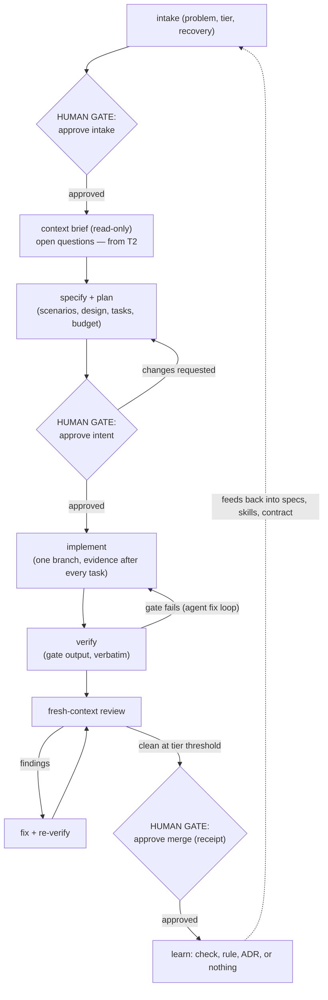
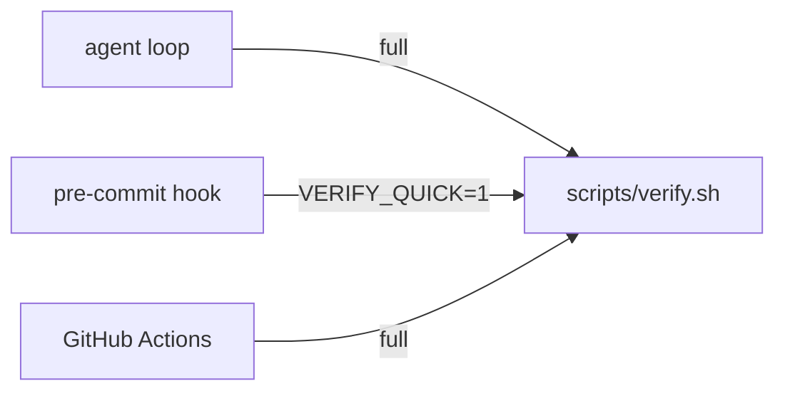

# SDLC — how changes ship in examples/go-rest

For the agent-side rules see [AGENTS.md](../AGENTS.md). This document defines
the pipeline, the human gates, the reversibility tiers, the findings
format, and the authoritative spec of the verification gate.

## Pipeline



## Human gates

| Gate                       | Decision                                                                     |
|----------------------------|------------------------------------------------------------------------------|
| Approve intake             | Does this deserve to exist, at this tier, with this recovery path?           |
| Approve intent (spec+plan) | Is this the right thing to build, stated correctly against the intake?       |
| Approve merge              | Is the implementation acceptable, informed by findings and the receipt?      |
| Approve production release | Is it safe to ship, now?                                                     |
| Weaken the gate            | Loosening any check, threshold, or stage — separate, stricter approval       |
| Three-way disagreements    | Which is wrong: code, spec, or test?                                         |
| Ask-first triggers         | Dependencies, secrets, destructive ops, spending, enforcement-surface changes|

Everything else is agent territory, evidence-gated.

## Reversibility tiers

Assigned by a human at intake, recorded in `changes/<slug>/intake.md`.
**Tier may be raised by anyone at any stage and lowered by nobody.** A
change with no stated recovery path is T3 by default.

| Tier | Undo cost             | Recovery path                         | Stages walked                | Findings that block |
|------|-----------------------|---------------------------------------|------------------------------|---------------------|
| T0   | Seconds               | `git revert`                          | 0, 2, 5, 6, 8, 11 *(light)*   | blocker              |
| T1   | Minutes               | Revert + redeploy                     | 0, 2, 5, 6, 7, 8, 11          | major and above      |
| T2   | Hours, user-visible   | Flag off, then revert                 | 0–8, 11                      | major and above      |
| T3   | Not fully recoverable | Rehearsed rollback + incident process | All + adversarial review      | all severities reviewed |

Minors never block; they are tracked. Intake and learn run at every tier.

## Findings

Review output that lives in chat is not review output:

```
id:         F-<change-slug>-<n>
severity:   blocker | major | minor | note
location:   <path>:<line> | <artifact>
reference:  <spec scenario, invariant, ADR, or contract rule>
claim:      what is wrong
basis:      the evidence for the claim
resolution: fixed <sha> | deferred <issue> | waived <reason + approver>
```

Unresolved findings at or above the tier threshold block merge. A waiver
names a human. A finding is a symptom of a missing check: ask which earlier
stage should have caught it, and move detection left.

## The verification gate — authoritative definition

`scripts/verify.sh` is the single definition of "works". One gate, three
runners — no runner has a private variant:



**If the script and this section ever disagree, that is a three-way
disagreement: a human decides which is wrong.**

Contract:

- Lives at `scripts/verify.sh`; executable; `set -euo pipefail`; runs from
  any cwd (it cds to the project root, i.e. its own `../`)
- shellcheck-clean (CI lints it)
- Prints one header per stage and fails fast at the first failing stage with
  verbatim output — that output is the agent's fix-loop input. Skipped
  stages print `skipped(<stage>, <reason>)` so evidence always shows what
  did not run

Stages, in order (numbered from zero):

| # | Stage          | Question it answers                                                                 |
|---|----------------|-------------------------------------------------------------------------------------|
| 0 | Traceability   | Does every check map to a spec node, every scenario to a check — and does an approved intake exist whose tier matches? |
| 1 | Shape          | Does it build, lint, type-check, and meet commit conventions? *(fmt, imports, vet, lint, build)* |
| 2 | Behaviour      | Do the spec's scenarios hold? *(table test per scenario, race-safe, coverage floor ≥ 70%)* |
| 3 | Invariants     | Do the stated properties hold under generated input? *(property / fuzz tests)*     |
| 4 | Test quality   | Would the tests notice if the code were wrong? *(mutation score on the diff — report-only first)* |
| 5 | Integration    | Does it work against a real environment, judged by something other than the agent? *(smoke)* |

Acceptance tests derive from approved scenarios, never from observed
output (the test-oracle trap). New machine checks ship report-only for at
least one change before they gate. Linter configuration lives in
`.golangci.yml` (staticcheck, errcheck, gosec, cyclop, revive). Thresholds
(coverage floor, complexity ceilings, mutation floor when it gates) change
only via an approved change that states the reason.

Modes: `VERIFY_QUICK=1` (the pre-commit runner) skips stages 4 and 5 only.
CI and the agent's final definition of done run all stages.

## The merge receipt

The merge commit records `Gate: <slug> <evidence-kind> green @ <short-sha>
(<date>)`. The evidence kind names what actually ran — `verify.sh` once the
gate exists, `manual review + hooks` before it — and is never overstated.
Enforced by `.githooks/pre-merge-commit`.

## Review checklist (fresh-context reviewer)

Design · Functionality · Complexity · Tests · Naming · Comments · Style ·
Docs — checked against the spec, not just the diff (after Google
eng-practices).

Line-budget evidence: paste the merge-base numstat actual
(`git diff --numstat $(git merge-base main HEAD)`, additions only,
excluding `changes/**`, `specs/**`, and `*.md`) next to the estimate stated
in the plan; a large overrun (≈2×) means split the change or record why.

## Release and learn (summarized here)

Conventional Commits drive the changelog and SemVer; releases carry signed,
checksummed artifacts with provenance; production deploys require an
environment approval; rollback is a runbook command
([docs/runbook.md](runbook.md)). Postmortems are blameless
([postmortem-template.md](postmortem-template.md)) and feed fixes back
into specs, skills, and the agent contract. Anything an agent has to
rediscover twice moves into a durable artifact — spec, contract rule, or
skill; chat history is not memory.
